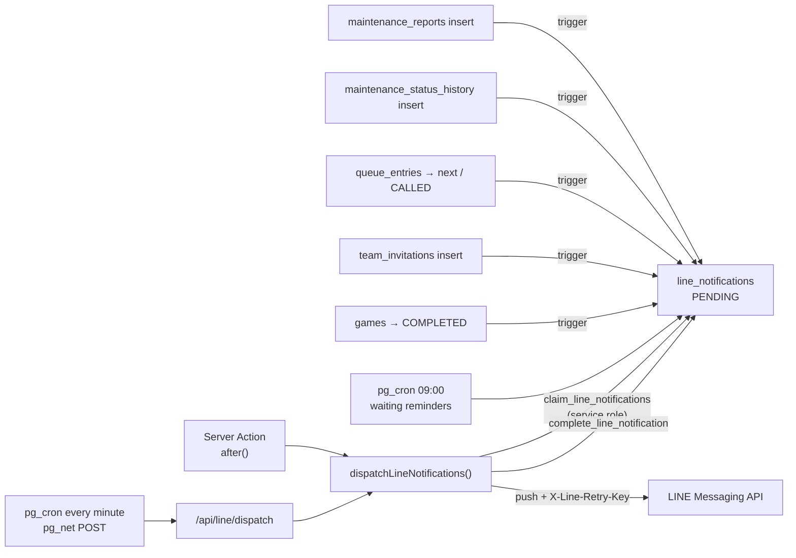

# LINE notifications

## Flow



| Event | Recipient | Expires |
| --- | --- | --- |
| New maintenance report | every `ADMIN` | 24 h |
| Report status changed | reporter | 24 h |
| Report `WAITING_FOR_CARETAKER` longer than `queue_settings.maintenance_reminder_days` (default 2) | every `ADMIN`, once per day | 12 h |
| Team becomes first in the waiting line | every current team member, once per queue entry | 30 min |
| Team called to check in | every current team member | check-in deadline |
| Invited to a team | invitee | 24 h |
| Game completed | every rostered player, with their own win or loss | 6 h |

Messages are plain Thai text without emoji; the triggers in the latest migration that redefines `private.notify_*` hold the exact wording. Court caretakers are never messaged. Admins phone them and track progress in the admin maintenance page.

Statuses: `PENDING` → `SENDING` → `SENT`, or `FAILED` (permanent error or 3 attempts), `EXPIRED` (not sent before `expires_at`), `SKIPPED` (recipient never signed in with LINE). While LINE is not configured, messages stay `PENDING` and expire, so turning LINE on later does not send a backlog of stale messages.

A recipient must have added the MeQ LINE Official Account as a friend to receive pushes. The LINE Login channel and the Messaging API channel must belong to the same LINE provider, otherwise the user ID from login does not match.

## Setup per environment

1. LINE Developers: create a **Messaging API** channel under the same provider as the LINE Login channel. Issue a long-lived channel access token.
2. App environment (`.env.local` and Vercel project settings), server only:
   - `LINE_MESSAGING_ACCESS_TOKEN`
   - `SUPABASE_SERVICE_ROLE_KEY` (Supabase → Project Settings → API keys, secret key)
   - `LINE_DISPATCH_SECRET`: any long random string
3. Supabase SQL editor, so the database cron can wake the dispatcher:
   ```sql
   select vault.create_secret('https://<production-domain>/api/line/dispatch', 'meq_line_dispatch_url');
   select vault.create_secret('<same value as LINE_DISPATCH_SECRET>', 'meq_line_dispatch_secret');
   ```
