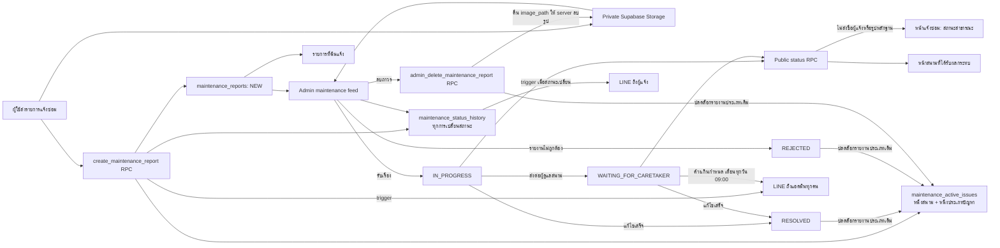

# Maintenance status flow

`NEW` is visible only to the reporter and administrators. The public feed starts after an administrator accepts the report and intentionally excludes reporter identity and private image paths. The active-issue registry prevents concurrent duplicate reports for the same court and category until all matching reports are closed (`RESOLVED` or `REJECTED`) or deleted.

Admins are the only people notified about reports. They phone the court caretaker and move the report to `WAITING_FOR_CARETAKER`; the caretaker never receives messages from the system. Every status change, with the admin note and admin name, is stored in `maintenance_status_history` and is readable only through `admin_list_maintenance_history`.

Administrators can hard-delete a report. The RPC returns the stored image path, and the server action removes that object from Storage, so the browser never chooses which file is deleted.
